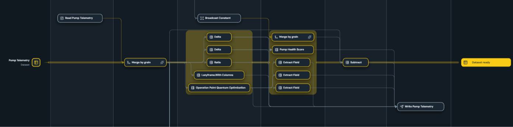

# Engine

The Engine executes the plan in a validated build bundle. It calls the Python
functions named by the plan, supplies their resolved arguments and runtime
data, and returns calculated outputs and execution details. It does not compile
or change the plan. The same bundle can run with different runtime parameters
and environment-specific resources.

## Invocation execution

The plan groups function invocations into dependency-ordered stages. The
current Engine processes stages and invocations sequentially. An invocation
runs only after its prerequisites succeed. If one fails, execution stops,
remaining invocations are marked skipped, and the result includes the failure.
Configured read and write functions are ordinary function calls and may have
external side effects.

## Datasets and fragments

A runtime Dataset is the Engine's accumulated dataframe for a profile defined in spec. As invocations run, the Engine
provides datasets to functions and updates them with produced results.

Some invocations transform the accumulated Dataset directly, preserving its
dimensional grain. They are yellow in the below picture.

Others use data from a different profile and grain. These
produce a fragment that is aligned with the target Dataset before being
merged. Those are the gray nodes (except the write invocation).

### Fragment and merge

A fragment is the partial dataframe produced by some data-producing compute
invocations. The Engine stages it without immediately changing the accumulated
Dataset. A separate merge invocation combines the fragment with the Dataset and
publishes the resulting complete dataframe. The built-in merge uses declared
dimension identifiers to align rows rather than relying on row position.
Depending on the fragment grain, it can combine full-grain data or add
lower-grain values to matching rows. A custom merge function can define
different assembly behavior. Other invocations, such as vectorized
transformations, return a complete target dataframe instead of a fragment.

## Dataframe backend

The plan declares the backend it requires, and the Engine checks compatibility
before execution. The built-in Engine supports the `polars` backend. Data
functions must return Polars `DataFrame` or `LazyFrame` values. Other dataframe
libraries and custom adapters are not supported.

## Engine configuration

Configuration is separate from the Spec and is supplied when the Engine is
created. Project configuration is read from `config/config.json`. Its `engine`
section contains backend settings, while the flat `params` map supplies scalar
values referenced by function arguments such as `$params.source_path`.

| Setting | Purpose |
| --- | --- |
| `engine.backend.type` | Names the configured engine environment. |
| `engine.backend.definition` | Optional path to engine-specific configuration. |
| `engine.backend.dataframe` | Selects the dataframe backend. The built-in Engine supports `polars`. |
| `engine.backend.evaluation` | Reserved setting. It does not currently change evaluation behavior. |
| `engine.backend.batch_size` | Reserved setting. It does not currently change data access or batching. |

Runtime parameters and resource locations can change between runs without
changing the plan. Changing Spec declarations or bindings requires a rebuild.
Backend compatibility and configuration checks run regardless of runtime
validation mode.

### Global parameters

The flat `params` map supplies required scalar values for function arguments
referenced as `$params.<name>`. Missing values fail when the function is
invoked. Parameters provide runtime controls such as input and output
locations, not profile data or analytical values.

## Runtime validation

Runtime contract validation is opt-in. Enable it with `uptimely run --validate`
or `Engine.run(validate=True)` to check declared inputs and
dataframe contracts as each invocation executes. Checks include required
features, declared types, key uniqueness, and preservation of existing rows,
keys, values, and order where the invocation contract requires it.

Some checks on lazy frames must evaluate queries and may repeat upstream work,
so validation can add substantial runtime. It checks declared contracts, not
whether analytical results are correct.

Some structural checks always apply, even when runtime validation is disabled.
For example, results must have the required dataframe structure, declared
outputs, and expected merge schema. Configuration, saved-build integrity, and
backend compatibility are also always checked.

## Results and previews

The Engine returns final profile dataframes, calculated feature outputs,
per-invocation statuses and durations, failures, and the plan version. A
successful invocation is marked succeeded, a failed invocation is marked
failed, and work that did not run after a failure is marked skipped.

Each run replaces the latest diagnostic snapshot in `_generated/run/`.
It includes run metadata, logs, and a bounded preview for each available
profile. The default preview is five rows. Previews are collected after
execution, including from lazy frames, and do not replace the dataframes
returned by the Engine. Preview failures are reported separately and do not
change the invocation status. Preview collection is outside the reported
execution duration.

Use the CLI `--preview` option to also display these samples after a successful
run. The saved previews are produced even when console display is not
requested.

The generated run directory is a latest-run snapshot, not an output store or
run history. Use a project's data output location for results intended to be
retained. Review logs and previews before sharing because they may contain
project data.

## Learn more

See the [Compiler and plan reference](compiler.md) for the execution-plan
contract, the [Engine CLI reference](../cli/engine.md) for run options and
artifacts, and the [Python Engine API](../python/engine.md) for programmatic
execution and result access.
