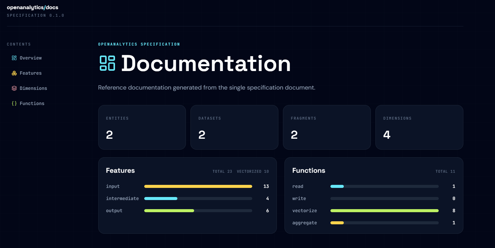
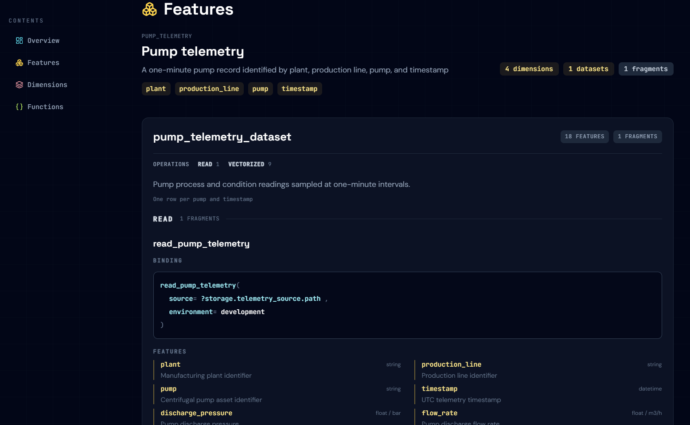

# Analytics documentation

Uptimely generates documentation from an
[Open Analytics Specification](../../specification/index.md). Feature definitions,
function bindings, and declared dependencies become a static website with three
connected views:

| Page | Purpose |
| --- | --- |
| Specification | Overview, Features, Entities, Datasets, Dimensions, and Functions pages, linked beneath Specification in the sidebar. Features are summarized per dataset with their producing mapping. |
| Feature lineage | Explore logical dependencies in interactive 2D and 3D views. |
| Execution plan | Overview summary, 2D and 3D callable graphs, and detailed parallel execution stages. |

The home page is a project dashboard: the specification name and version,
compact counts for entities, datasets, features, functions, compiled operations,
and execution stages, and a visual journey through the three views. The site
brand returns to this dashboard from any page. Projects without a name display
"Untitled analytics project".

Counts describe declared resources and the compiled plan, not live execution
results. The dashboard does not run analytics. This website documents the
analytics project, not the Uptimely package itself.



## Build the website

### Command line

```sh
uptimely docs build --spec _generated/spec/spec.json
```

The command exports this directory:

```text
_generated/docs/
├── index.html
├── graph/
│   ├── 2d.html
│   └── 3d.html
├── plan/
│   ├── 2d.html
│   ├── 3d.html
│   ├── overview.html
│   └── stages.html
└── spec/
    ├── datasets.html
    ├── dimensions.html
    ├── entities.html
    ├── features.html
    ├── functions.html
    └── overview.html
```

Start at `index.html`. `spec/overview.html` contains the specification overview;
the other specification pages under `spec/` contain only their respective
sections. The Specification sidebar group provides subnavigation and highlights
the current section. The Features page summarizes features by dataset and
identifies the producing mapping; the Entities and Datasets pages provide
focused views of those specification resources.
Feature graph provides separate 2D and 3D lineage views under `graph/` (`2d.html`
and `3d.html`).
Execution plan has Overview, 2D graph, 3D graph, and Stages subnavigation under
`plan/` (`overview.html`, `2d.html`, `3d.html`, and `stages.html`).
Overview contains summary counts; the 2D graph groups callable operations into
vertical lanes by dependency stage, and the graph pages show compiled callable
operations and their dependencies rather than feature-lineage nodes.
Stages lists dependency-ordered operations with their arguments and return types.
Each report is a complete HTML page, with relative links to
the other reports. The directory can be moved or hosted beneath a URL prefix
without rebuilding its page navigation.

The build options are:

| Option | Behavior |
| --- | --- |
| `--spec` | Required path to a JSON specification. |
| `--output` | Website directory; defaults to `_generated/docs`. |
| `--project-root` | Directory added to Python's import path; defaults to the working directory. |
| `--include-generated-at` | Show a build timestamp on the specification page. |

For a project outside the working directory:

```sh
uptimely docs build \
  --spec analytics/_generated/spec/spec.json \
  --project-root analytics \
  --output public/analytics
```

Specification and output paths are relative to the working directory, not to
`--project-root`. The import root lets Uptimely inspect the declared function
entrypoints when compiling the execution plan.

Building imports function modules and inspects signatures, but does not invoke
analytical functions or run the engine. Use trusted specifications and
implementations, with their dependencies installed. Invalid specifications,
compilation failures, and export errors produce an error message and a nonzero
exit status.

### Python API

```python
from uptimely.docs.docs import Documentation
from uptimely.spec import Specification

specification = Specification.from_json("_generated/spec/spec.json")
documentation = Documentation(specification)
index_path = documentation.create_html()
```

The generator also accepts an in-memory `Specification`; no source JSON path is
required. Function entrypoints must still be importable.

Unlike the CLI's `--output` directory, the Python API's `output_path` is an
**index-file path**:

```python
index_path = documentation.create_html(
    output_path="public/analytics/index.html",
)
```

All graph, execution-plan, and specification pages are written beside the index.
The index filename cannot match any of their filenames shown above.
HTML generation always produces the complete website; exporting an individual
report or a graph subset as HTML is not supported.

The module-level `uptimely.docs.docs.create_html(specification, output_path=...)`
helper generates the same complete website and returns its index path.

Timestamps are disabled by default for reproducible exports. Pass
`include_generated_at=True` to display one on each specification section page.

## Preview and publish

```sh
uptimely docs serve
```

This serves an existing `_generated/docs/` website at
<http://127.0.0.1:8001/>. Port **8001** is separate from the project documentation's
MkDocs preview on port **8000**.

| Option | Behavior |
| --- | --- |
| `--directory` | Website directory; defaults to `_generated/docs`. Must contain `index.html`. |
| `--host` | Bind address; defaults to `127.0.0.1`, restricting access to the local machine. |
| `--port` | TCP port; defaults to `8001`. Use `0` to select an available port. |

The server prints its address at startup. Stop it with **Ctrl+C**. It serves
existing files; it does not generate, watch, or rebuild the website.

To build and preview the end-to-end example from a repository checkout:

```sh
./scripts/serve-example-docs.sh
```

The script builds the full website using Poetry, then serves it at
<http://localhost:8001/>. It locates the repository independently of the working
directory and passes its arguments to the preview server, for example
`./scripts/serve-example-docs.sh --port 8002`.

The preview server has no authentication or TLS and is not intended for
production hosting. Binding to `0.0.0.0` exposes files on all IPv4 interfaces.
Serve only a directory intended for publication, without sensitive files or
symlinks to private content.

For deployment, publish the generated directory through a static web host. No
Python application server is needed. Use authenticated hosting for private
specifications. The pages currently load styling, fonts, icons, and graph
libraries from external services; full styling and visualization require network
access.

## Understand the feature graph

### Logical dependencies versus physical data flow

A warehouse schema, ETL diagram, or execution trace describes where data is
stored or processed. It does not necessarily explain what a feature means or
which other features it depends on.

For example, a table containing values for `A` and `B` does not reveal that a
calculation produces `B` from `A`, what their types are, or which downstream
features consume `B`. Reading `calculate_b(a)` in Python also leaves questions
about its inputs, outputs, and surrounding workflow.

The specification declares those relationships explicitly. Uptimely visualizes
them without trying to infer arbitrary Python behavior from source code. The
graph reflects the declared model, not dependencies or side effects that
functions leave undeclared.

### 3D lineage

The interactive 3D graph uses:

- **Blue spheres** for features, including source-provided and calculated features.
- **Octahedra colored by operation type** for functions.
- **Directed arrows** for dependency connections.

The legend identifies read, vectorize, collapse, conform, expand, and write
functions. Select a node to inspect its feature or function metadata.

### 2D lineage

Choose the 2D lineage view when you want to follow upstream inputs through
calculations to downstream features. It keeps the standard layered node-card
layout and directional links, with horizontal swim lanes labeled by
specification entity. Nodes are stacked vertically within each lane and rank
without overlapping. Nodes without an entity are grouped in an `Unassigned` lane.
Both renderings include the same node details. Website generation includes
both views; open their links under Feature graph in the sidebar.

The feature graph explains logical lineage; the
[execution plan](../compiler/index.md) separately shows callable dependencies and
execution stages.

### Focus on a feature

The Python graph API can inspect the upstream dependency subset needed for a
selected feature without exporting HTML:

```python
from uptimely.analytics import FeatureGraph

graph = FeatureGraph(specification)
subset = graph.subset(["health_signal_normalized"])
subset.print_graph()
```

This is useful for debugging or reviewing a calculation. Subset analysis remains
available in Python, while the website displays the full feature graph.

## Migrating from standalone HTML reports

The standalone methods `Specification.create_html`, `FeatureGraph.export_html`
(including subsets), and `ExecutionPlan.export_html` have been removed. Replace
those calls with a single website-generation call using the original specification:

```python
from uptimely.docs import docs

index_path = docs.create_html(
    specification,
    output_path="public/analytics/index.html",
)
```

Publish or move the entire output directory, not just its index. A portable plan
alone is not a website input: generation needs the specification and importable
function entrypoints. Specification JSON export, plan JSON export, and graph
analysis are unchanged.

## Reference data

Reference JSON is a separate export:

```python
data_path = documentation.create_json()  # _generated/docs/docs.json
```

It contains the specification configuration, summary counts, feature
dependencies, and optional generation timestamp. Neither `Documentation.create_html`
nor `uptimely docs build` automatically writes this JSON. The example's
`run_docs.py` calls both exports.



See the [Python API reference](../../reference/api.md#analytics-documentation) for
the documentation interface and the
[feature graph API](../../reference/api.md#dependency-graphs) for graph operations.

## Template organization

All website pages use Jinja templates in `src/uptimely/templates/`. The root
`base.html.j2` provides the shared layout and website navigation.
The root `index.html.j2` renders the website landing page. Subdirectories group
the specification reference, individual page templates, and shared sections (`spec/`),
feature graph (`graph/`), and
execution plan (`plan/`).

Renderers stay in their component modules and share the package template loader
in `uptimely.render`. Template inheritance and includes use paths relative to the
central template directory, such as `spec/sections/entities.html.j2`. The
templates are included in the installed Python package, so website generation
works outside a repository checkout. Component page renderers are internal
implementation details, not alternative public HTML export APIs.
