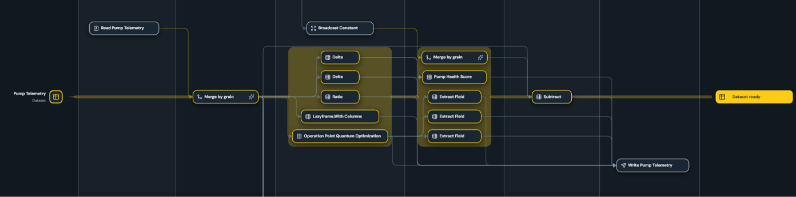

# Datasets and fragments

Each logical profile is associated with a physical dataset to which functions accumulate columns based on logical operator declarations.

## Dataset accumulation

Here is an example datasets could accumulate columns by each function call.

Operator A loads the seed dataset with only the dimension columns. However, it could already load features as well.

The following operators B, C and D produce new columns to achive to calculate the ratio eventually.

  

    

      <table class="cv-table cv-model-table">
        <thead>
          <tr class="cv-bands"><th colspan="2" class="cv-key">DIMENSIONS / operator A</th><th colspan="2" class="cv-teal">TELEMETRY / operator B</th><th class="cv-violet">REFERENCE / operator C</th><th class="cv-amber">CALCULATED / operator D</th></tr>
          <tr><th class="cv-key">cooling pump</th><th class="cv-key">timestamp</th><th class="cv-teal">differential pressure</th><th class="cv-teal">flow</th><th class="cv-violet">reference</th><th class="cv-amber">pressure ratio</th></tr>
        </thead>
        <tbody>
          <tr><td class="cv-key">P-01</td><td class="cv-key">09:00</td><td class="cv-teal">6</td><td class="cv-teal">12</td><td class="cv-violet">8</td><td class="cv-amber">0.75</td></tr>
          <tr><td class="cv-key">P-01</td><td class="cv-key">09:01</td><td class="cv-teal">8</td><td class="cv-teal">14</td><td class="cv-violet">8</td><td class="cv-amber">1.00</td></tr>
          <tr><td class="cv-key">P-01</td><td class="cv-key">09:02</td><td class="cv-teal">4</td><td class="cv-teal">10</td><td class="cv-violet">8</td><td class="cv-amber">0.50</td></tr>
        </tbody>
      </table>
    

  

The combined profile dataframe is fundamentally a calculated view, not a requirement to store all intermediate columns in one physical table.

## Fragments and Datasets

A dataset is directly associated to a profile.

When dataset requires data from other profile, the operation happens in two step. First there is a compute operation that prepares the dataframe, but is still disconncted from the target dataset.

In the seconds step the fragment is merged to the dataset.

## Dataset lineage

In the picture below, direct dataset computations are yellow and fragment-producing calls
are gray, except for the write invocation.

### Materialization

Operators with input features but and no output features can materialize the results to files, database or simply log the results.
